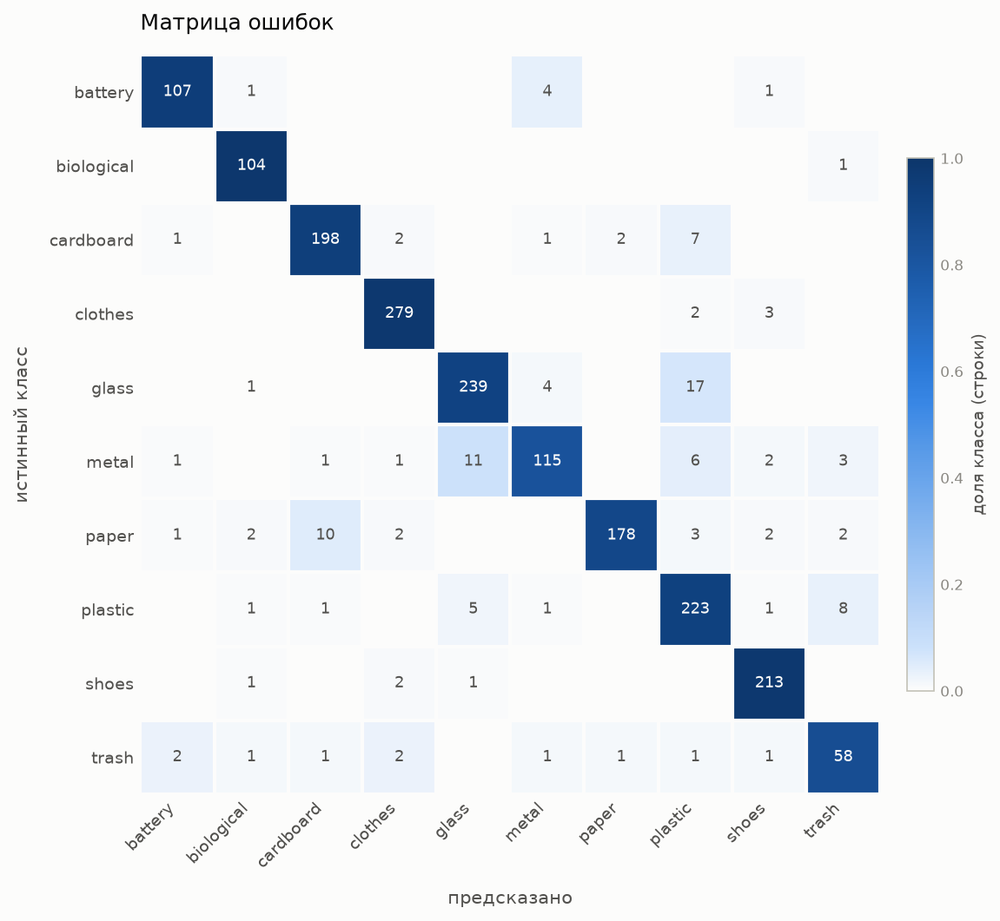
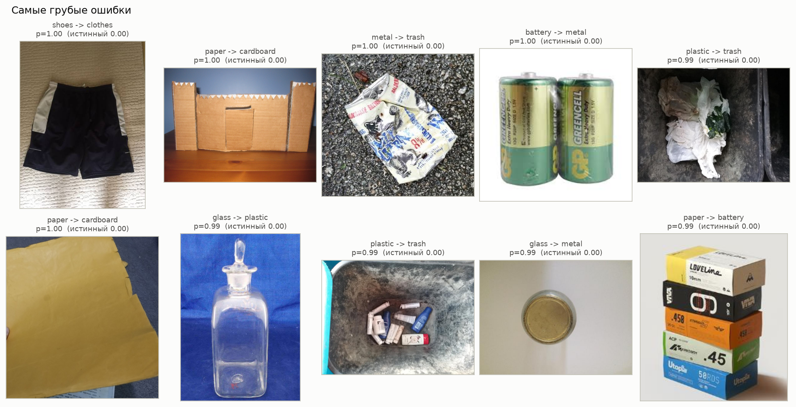
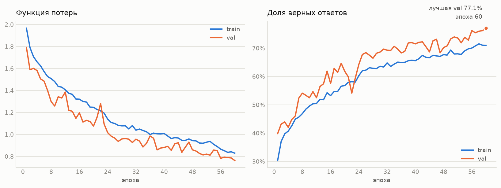

# Классификация мусора по фотографии

Классификатор фотографий отходов на 10 классов: дообученный ResNet18 даёт **93.2%** accuracy на тесте против **76.6%** у свёрточной сети, обученной с нуля. **[Открыть демо](https://huggingface.co/spaces/gapkold/trash-classification)** — работает целиком в браузере, без сервера.


[](https://github.com/Wapkold/garbage-classification/actions/workflows/tests.yml)
[](LICENSE)



*Матрица ошибок лучшей модели (ResNet18, backbone разморожен) на тестовой выборке из 1 839 изображений.*

## Ключевые результаты

- **93.2% accuracy и 0.925 balanced accuracy** на тесте (1 839 изображений) — ResNet18 с размороженным backbone; macro F1 0.924.
- **Предобученные веса решают**: замороженный ResNet18 с 5 130 обучаемыми параметрами даёт 0.873, разморозка backbone добавляет ещё **+5.9 п.п.**; своя CNN за 60 эпох — 0.766.
- **Утечка в данных учтена**: серый паддинг в «стандартизированных» вариантах датасета коррелирует с классом (43% файлов у `battery` против 95% у `biological`), поэтому обучение идёт на `original`.
- **Инференс в браузере**: модель в ONNX int8 весит **11.2 МБ** (fp32 — 44.7 МБ, исходный PyTorch-чекпоинт с состоянием оптимизатора — 134 МБ), accuracy 0.9200, ~114 мс на изображение.
- **Обучение 18 секунд на эпоху** на RTX 3070: настройка загрузки данных дала ускорение в 5.3 раза.

## Содержание

- [Задача](#задача)
- [Данные](#данные)
- [Подход](#подход)
- [Результаты](#результаты)
- [Демо в браузере](#демо-в-браузере)
- [Ограничения](#ограничения)
- [Структура проекта](#структура-проекта)
- [Запуск](#запуск)
- [Лицензия](#лицензия)

## Задача

Раздельный сбор упирается в сортировку: человек у контейнера должен за секунду решить, куда отправить предмет, и ошибается тем чаще, чем больше категорий. Задача — по одной фотографии отнести предмет к одному из 10 типов отходов.

Два подхода к одной задаче — свёрточная сеть, обученная с нуля, и transfer learning на ResNet18 — собраны в одном пайплайне и сравниваются на общей отложенной выборке.

Что считается успехом:

- **основная метрика — balanced accuracy**, а не обычная accuracy. Классы несбалансированы в 4.2 раза, и модель, игнорирующая редкие категории, может показать приличную accuracy, оставаясь бесполезной именно там, где ошибка дороже (батарейка в общем баке — это не то же самое, что картон в бумаге);
- инференс должен укладываться в доли секунды на обычном железе.

## Данные

[Garbage Classification](https://www.kaggle.com/datasets/mostafaabla/garbage-classification) (Kaggle) — 12 259 изображений, 10 классов.

| Класс | Всего | Train | Val | Test |
|---|--:|--:|--:|--:|
| battery | 756 | 529 | 114 | 113 |
| biological | 699 | 489 | 105 | 105 |
| cardboard | 1 411 | 988 | 212 | 211 |
| clothes | 1 892 | 1 325 | 283 | 284 |
| glass | 1 736 | 1 215 | 260 | 261 |
| metal | 930 | 651 | 139 | 140 |
| paper | 1 336 | 935 | 201 | 200 |
| plastic | 1 597 | 1 118 | 239 | 240 |
| shoes | 1 449 | 1 014 | 218 | 217 |
| trash | 453 | 317 | 68 | 68 |
| **Итого** | **12 259** | **8 581** | **1 839** | **1 839** |

Разбиение 70/15/15 **стратифицированное**. При случайном сплите доля самого редкого класса (`trash`, 453 файла) гуляет настолько, что per-class recall становится несопоставим между запусками.

### Утечка: серый паддинг в «стандартизированных» вариантах

Датасет содержит три варианта одних и тех же изображений: `original`, `standardized_256` и `standardized_384`. Оба стандартизированных приведены к квадрату **дополнением серым полем** (RGB 114, 114, 114). Замер по 60 файлов на класс:

| Вариант | Файлов с полями | Среднее поле | Максимум |
|---|--:|--:|--:|
| `original` | 0% | 0% | 0% |
| `standardized_256` | 77% | 21% кадра | 76% |
| `standardized_384` | 79% | 22% кадра | 73% |

Доля файлов с полями заметно зависит от класса — 43% у `battery` против 95% у `biological`. То есть **количество серого коррелирует с меткой**, и сеть может читать его вместо самого объекта: утечка препроцессинга в целевую переменную.

Поэтому проект работает с `original`, а к нужному размеру изображения приводят трансформы: `Resize(256)` по короткой стороне (пропорции сохраняются) + кадрирование до 224. Вариант `Resize((256, 256))` сплющил бы вытянутые кадры — бутылка, сжатая по вертикали, начинает выглядеть как банка.

<details>
<summary><b>Цена перехода на <code>original</code></b></summary>

Замер на 800 файлах: медианное соотношение сторон 1.33 (p95 = 1.85), центральный кроп сохраняет ~57% площади исходника. У 33% файлов короткая сторона меньше 224 px, то есть они апскейлятся — в стандартизированных вариантах это уже произошло, просто молча.

</details>

## Подход

### Аугментации

Принцип: аугментация имитирует вариативность, которая в реальных фото есть, но **не является признаком класса**. Всё, что реально различает классы, трогать нельзя.

| Приём | Зачем |
|---|---|
| `RandomHorizontalFlip` | у бутылки нет канонической левой стороны; отражение — валидное изображение того же класса |
| `RandomRotation(±15°)` | снимки сделаны с рук, наклон камеры случайный |
| `ColorJitter` | освещение гуляет (кухня, улица, вспышка) |
| `RandomCrop(224)` из 256 | объект оказывается в разных местах кадра |

<details>
<summary><b>Тонкости, которые важнее самого списка</b></summary>

- **`hue` ограничен 0.03** при `brightness/contrast/saturation = 0.25`. Для мусора цвет — настоящий разделяющий признак: коричневый картон против белой бумаги, зелёное стекло. Крутить оттенок широко значит превращать картон в бумагу прямо в обучающей выборке;
- **углы после поворота заливаются ImageNet-средним**, а не чёрным. После нормализации такая заливка даёт ≈0 — нейтральный пиксель. Чёрные углы сеть быстро выучивает как метку «здесь была аугментация»;
- **вертикального флипа нет намеренно**: на упаковке есть текст и логотипы, а перевёрнутый текст в реальных данных не встречается.

Нормализация — ImageNet mean/std. Для transfer это обязательно (предобученные слои калиброваны под это распределение), для сети с нуля — безвредное фиксированное преобразование.

</details>

### Архитектуры

| | Своя CNN (`SimpleCNN`) | Transfer learning (`TransferResNet18`) |
|---|---|---|
| признаки | 4 свёрточных блока `Conv3x3 → BN → ReLU → MaxPool`, каналы 32→64→128→256 | свёрточная часть ResNet18 с весами ImageNet-1k, 512 признаков на выходе |
| голова | Global Average Pooling + `Linear(256 → 10)` | новый `Linear(512 → 10)` |
| параметров | **391 466** | 11 181 642; при замороженном backbone обучается **5 130** (0.05%) |

<details>
<summary><b>Почему своя CNN устроена именно так</b></summary>

- **Число блоков задано с двух сторон.** Сверху — размером выборки: ~8.6k обучающих изображений при 391k параметров это уже ~45 параметров на картинку; при 8 блоках счёт ушёл бы за 5M и сеть выучила бы выборку наизусть. Снизу — рецептивным полем: после 3 блоков оно 22 px (масштаб отдельного края), после 4 — 46 px (масштаб фактуры: складка бумаги, блик на стекле).
- **MaxPool внутри блоков, GAP в голове.** Максимум отвечает на вопрос «признак есть где-то поблизости?», игнорируя точную позицию — то, что нужно детекторам краёв. В голове наоборот нужно среднее: доля кадра с данной фактурой — осмысленный признак класса.
- **GAP вместо Flatten экономит 25.7M параметров.** Классический `Flatten + Linear(256·14·14 → 512)` стоил бы 25 690 624 параметра — в 65 раз больше всей остальной сети, и именно там такие модели переобучаются.
- **BatchNorm** позволяет держать LR на порядок выше и не подбирать инициализацию идеально; `bias=False` у свёрток, потому что у BN есть свой сдвиг.
- **Kaiming He init**: ReLU обнуляет половину значений, без поправки дисперсия активаций затухает вглубь.

</details>

<details>
<summary><b>Тонкость transfer learning: «замороженный» backbone без BN-заморозки уплывает</b></summary>

`requires_grad = False` останавливает градиенты, но **не** running-статистики BatchNorm — в train-режиме они продолжают пересчитываться под наш датасет, и «замороженный» backbone медленно уплывает без единого шага оптимизатора. Отладить это тяжело: ошибок нет, просто метрика хуже, чем должна быть. Поэтому `TransferResNet18` переопределяет `.train()` и держит BN в `eval`, когда backbone заморожен.

</details>

### Обучение

| Параметр | Значение |
|---|---|
| seed | `--seed 42` (по умолчанию) во всех прогонах: фиксирует и разбиение на train/val/test, и инициализацию |
| оптимизатор | AdamW, lr 1e-3, weight decay 1e-4; при разморозке backbone — lr 1e-4 |
| расписание LR | `ReduceLROnPlateau` **по val accuracy**: раз модель отбирается по этой метрике, по ней же логично резать LR |
| веса классов | обратны частоте (`--class-weights`) |

<details>
<summary><b>Производительность: 18 секунд на эпоху вместо 90</b></summary>

Обучение на RTX 3070 (i7-8700K, 6 ядер / 12 потоков): **18 секунд на эпоху**, первая эпоха 139 секунд.

Узким местом оказалась не арифметика, а загрузка данных. С четырьмя воркерами эпоха занимала 90 секунд — столько же, сколько на CPU при вчетверо меньшей стороне кадра: видеокарта простаивала, ожидая распаковки 8 581 JPEG. Вдобавок на Windows воркеры порождаются через spawn и **пересоздавались каждую эпоху**, заново импортируя CUDA-сборку torch. `persistent_workers=True`, увеличенный `prefetch_factor` и подбор числа воркеров от числа потоков дали ускорение в 5.3 раза; дорогая первая эпоха — это разовый старт воркеров.

</details>

## Результаты

Тестовая выборка — 1 839 изображений, ни разу не участвовавших в обучении.

| Прогон | Модель | Обучаемых параметров | Эпох | Test accuracy | Balanced accuracy | Macro F1 |
|---|---|--:|--:|--:|--:|--:|
| **`resnet18_finetune`** | ResNet18, backbone разморожен | 11 181 642 | 15 | **0.932** | **0.925** | **0.924** |
| `resnet18_transfer` | ResNet18, backbone заморожен | 5 130 | 10 | 0.873 | 0.872 | 0.862 |
| `simple_cnn_60ep` | своя CNN | 391 466 | 60 | 0.766 | 0.760 | 0.762 |
| `simple_cnn` | своя CNN | 391 466 | 25 | 0.694 | 0.689 | 0.689 |

Три вывода из таблицы:

1. **Предобученные веса решают.** Даже линейный пробинг — 5 130 обучаемых параметров против 391 466 — обгоняет сеть с нуля на 18 п.п., обучаясь вдвое меньше эпох. Ни при каком бюджете эпох своя CNN этот разрыв не закрыла.
2. **Разморозка backbone даёт ещё +5.9 п.п.** (0.873 → 0.932). Замороженные ImageNet-признаки хороши, но не заточены под материалы; дообучение на lr 1e-4 адаптирует их, не разрушая.
3. **Своей CNN не хватало эпох, а не архитектуры**: +7.2 п.п. от простого продления с 25 до 60 эпох. При этом и на 60-й эпохе она показала свой лучший результат — то есть **не сошлась и там**.

Близость accuracy и balanced accuracy во всех прогонах (0.932 против 0.925 у лучшего) означает, что взвешивание классов сработало: модель не выехала за счёт крупных классов.

### По классам

| Класс | F1, finetune | F1, замороженный | F1, своя CNN (60 эпох) |
|---|--:|--:|--:|
| clothes | 0.976 | 0.975 | 0.836 |
| shoes | 0.968 | 0.964 | 0.744 |
| biological | 0.963 | 0.957 | 0.883 |
| battery | 0.951 | 0.911 | 0.767 |
| cardboard | 0.938 | 0.891 | 0.791 |
| paper | 0.934 | 0.825 | 0.743 |
| glass | 0.925 | 0.847 | 0.791 |
| plastic | 0.894 | 0.771 | 0.693 |
| metal | 0.865 | 0.785 | 0.683 |
| trash | 0.829 | 0.693 | 0.686 |

Порядок классов по сложности у всех трёх моделей одинаков — значит трудность задаётся самими данными, а не архитектурой. Больше всего от дообучения выиграли `trash` (+0.136), `plastic` (+0.123) и `paper` (+0.109): именно те классы, где нужны материаловедческие признаки, которых в ImageNet-предобучении нет.

### Разбор ошибок

**Лучшие классы — `clothes` и `shoes`** (F1 0.976 и 0.968). Прямое следствие того, что в ImageNet-1k есть `jersey`, `running shoe` и подобные категории: предобученные признаки заточены ровно под них. Показательно, что дообучение их почти не улучшило (+0.001 и +0.004) — там и так был потолок.

**Худший класс — `trash`** (F1 0.829). Класс-помойка без аналога в ImageNet, определяемый через «ничего из остального». Именно он больше всех выиграл от дообучения (+0.136): признаки для него приходится выучивать с нуля, а замороженный backbone этого не умеет по определению.

**Основная масса оставшихся ошибок — кластер блестящих ёмкостей.** У замороженной модели `plastic` → `glass` 33 случая, `glass` → `plastic` 16, `plastic` → `metal` 14. Различает их не форма и не текстура, а тонкие свойства материала — прозрачность, характер бликов. Дообучение сократило этот кластер, но не убрало: `metal` остаётся слабейшим по recall (0.821).



*Самые грубые ошибки дообученного ResNet18 на тесте: истинный класс → предсказанный и уверенность модели.*

**Своя CNN не сошлась даже за 60 эпох**: свой лучший результат она показала на самой последней эпохе, кривые потерь всё ещё падают, а расхождения train/val нет вовсе — переобучение не началось. Это ответ на вопрос «мало эпох или мала модель»: пока мало эпох.



*Кривые обучения своей CNN за 60 эпох: лучшая val accuracy достигнута на последней, 60-й эпохе.*

## Демо в браузере

Демо развёрнуто на [Hugging Face Spaces](https://huggingface.co/spaces/gapkold/trash-classification). Интерфейс показывает вероятности классов и подсказку, что делать с предметом.

Развёрнутое демо — **статический** Space: HTML, JS и файл модели, без Python на сервере. Модель уезжает в ONNX и считается через `onnxruntime-web` **на устройстве посетителя**: нет холодного старта, нет лимитов по запросам, фотографии никуда не отправляются. В браузере ~114 мс на изображение.

<details>
<summary><b>Почему статический Space</b></summary>

Так вышло не от хорошей жизни: Hugging Face теперь требует PRO-подписку для Gradio- и Docker-Spaces даже на бесплатном железе (`402 Payment Required` при попытке создать). Бесплатными остались только статические. Ограничение обернулось плюсом — инференсом на устройстве посетителя.

</details>

<details>
<summary><b>Экспорт в ONNX и квантизация: замеры</b></summary>

`export_onnx.py` делает ONNX + квантизацию + сверку точности, `build_static_space.py` собирает `deploy_static/` (11.5 МБ); команды — в разделе [Запуск](#запуск).

Замеры экспорта на тестовой выборке:

| Модель | Размер | Accuracy | Совпадений с PyTorch |
|---|--:|--:|---|
| PyTorch | 134 МБ | 0.9325 | — |
| ONNX fp32 | 44.7 МБ | 0.9325 | 100% (max \|Δ\| логита = 0.0000) |
| **ONNX int8** | **11.2 МБ** | 0.9200 | 96.75% |

Развёрнут int8: страницу открывают с телефона, и вчетверо меньший трафик важнее одного процентного пункта. Флаг `--precision fp32` собирает вариант без потерь.

</details>

<details>
<summary><b>Предобработка: одна и та же при оценке (val/test), в Python-демо и в браузере</b></summary>

Предобработка в демо берётся из `src.dataset.get_eval_transforms()`, а не пишется заново: любое расхождение с валидацией (другой ресайз, забытая нормализация) дало бы молчаливую деградацию — модель работает, но хуже, и понять это по интерфейсу невозможно.

**Предобработка на JS повторяет `get_eval_transforms()`** — `Resize(256)` по короткой стороне, `CenterCrop(224)`, нормализация под ImageNet. Сверено на живых данных: максимальное расхождение логитов между браузером и Python — **0.085** при величине логитов около 9 (разница ресемплинга canvas и PIL), предсказания идентичны. В браузере 10/10 на примерах.

</details>

<details>
<summary><b>Gradio-Space и облегчённый чекпоинт</b></summary>

Вариант с Gradio-Space собирается `python build_space.py` в папку `deploy/` — он готов и проверен, но требует платного тарифа.

Чекпоинт выгружается через `export_for_inference()` — **134 МБ → 45 МБ**. Разница — это состояние оптимизатора AdamW: он хранит по два момента на параметр, что при полном fine-tuning вдвое тяжелее самих весов. Для продолжения обучения нужно, для инференса — мёртвый груз.

Код в `deploy/` не переписывается, а копируется: отдельная «версия для деплоя» неизбежно разъехалась бы с оригиналом. Одно и то же `app.py` работает в обоих местах — на Space оно находит `model.pt` и `examples/` рядом с собой, локально берёт лучший чекпоинт из `checkpoints/` и картинки из датасета.

</details>

## Ограничения

- **Блестящие ёмкости путаются между собой.** `plastic`, `glass` и `metal` различаются тонкими свойствами материала; дообучение сократило этот кластер ошибок, но не убрало — `metal` остаётся слабейшим по recall (0.821).
- **`trash` — худший класс** (F1 0.829): у него нет аналога в ImageNet, он определяется через «ничего из остального».
- **Своя CNN не доведена до сходимости**: лучший результат — на последней, 60-й эпохе, переобучение не началось. Её 0.766 упирается в число эпох, а не в архитектуру.
- **Квантизация стоит точности**: развёрнутая int8-модель даёт 0.9200 против 0.9325 у fp32.
- **Браузерная предобработка не совпадает с PIL бит в бит**: из-за ресемплинга canvas логиты расходятся до 0.085; предсказания на проверенных данных идентичны.

## Структура проекта

```text
garbage-classification/
├── data/
│   └── garbage_classification/     # датасет (в git не попадает)
├── notebooks/
│   └── 01_eda.ipynb                # разведочный анализ
├── src/
│   ├── dataset.py                  # ImageFolder, трансформы, стратифицированный сплит
│   ├── model.py                    # SimpleCNN и TransferResNet18, чекпоинты
│   ├── train.py                    # цикл обучения, learning curves
│   └── evaluate.py                 # метрики, матрица ошибок, разбор ошибок
├── app/
│   └── app.py                      # Gradio-демо
├── checkpoints/<прогон>/best.pt    # веса (в git не входят, создаются обучением)
├── reports/<прогон>/               # метрики и графики
├── static/index.html               # исходник страницы для браузерного инференса
├── tests/                          # pytest: архитектуры, сплит, препроцессинг демо
├── onnx/                           # экспортированная модель (генерируется)
├── deploy_static/                  # пакет статического Space (генерируется)
├── deploy/                         # пакет Gradio-Space (генерируется)
├── .github/workflows/tests.yml     # CI: pytest на CPU-сборке torch
├── export_onnx.py                  # экспорт в ONNX + квантизация + сверка
├── build_static_space.py           # сборка deploy_static/
├── build_space.py                  # сборка deploy/
├── pytest.ini
├── requirements.txt
├── LICENSE
└── README.md
```

## Запуск

### Установка

```bash
pip install -r requirements.txt
```

> [!WARNING]
> На Windows `pip install torch` ставит сборку **без** CUDA. Подробности и правильная команда — в комментариях [`requirements.txt`](requirements.txt).

### Обучение

Результаты раскладываются по `checkpoints/<прогон>/` и `reports/<прогон>/`, поэтому прогоны не затирают друг друга.

```bash
python -m src.train --arch resnet18_transfer --epochs 15 --unfreeze --lr 1e-4 --class-weights --run-name resnet18_finetune
python -m src.train --epochs 60 --class-weights --run-name simple_cnn_60ep
```

`--unfreeze` требует пониженного `--lr`: на 1e-3 предобученные веса разрушаются на первых же шагах.

### Оценка

```bash
python -m src.evaluate --checkpoint checkpoints/resnet18_finetune/best.pt --split test
```

### Демо локально

Модель выбирается автоматически — лучшая по val accuracy среди всех прогонов.

```bash
python app/app.py
```

Открывается на http://localhost:7860. Можно загрузить своё изображение или кликнуть пример из датасета — по одному на каждый класс.

### Сборка демо для Hugging Face

```bash
python export_onnx.py          # ONNX + квантизация + сверка точности
python build_static_space.py   # собирает deploy_static/ (11.5 МБ)
python build_space.py          # Gradio-вариант в deploy/ (нужен платный тариф)
```

### Тесты

Данные и GPU не нужны, ResNet18 создаётся без скачивания весов.

```bash
python -m pytest
```

Тесты проверяют число параметров из таблицы выше, стратификацию и воспроизводимость сплита, заморозку BatchNorm и то, что JS-препроцессинг и порядок классов в браузерном демо совпадают с Python.

### Полезные флаги

| Флаг | Скрипт | Назначение |
|---|---|---|
| `--run-name` | `src.train` | имя прогона |
| `--arch` | `src.train` | выбор архитектуры |
| `--unfreeze` | `src.train` | разморозить backbone ResNet18 (требует пониженного `--lr`) |
| `--class-weights` | `src.train` | веса классов обратно частоте |
| `--seed` | `src.train`, `src.evaluate` | фиксирует разбиение и инициализацию (по умолчанию 42); при оценке должен совпадать с обучением |
| `--num-workers 0` | `src.train`, `src.evaluate` | если на Windows падает spawn |
| `--precision fp32` | `build_static_space.py` | вариант без квантизации |

## Лицензия

[MIT](LICENSE)
